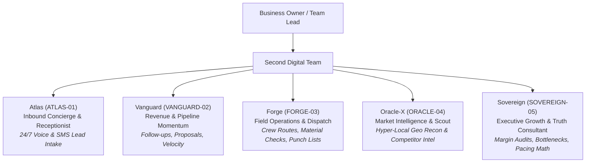
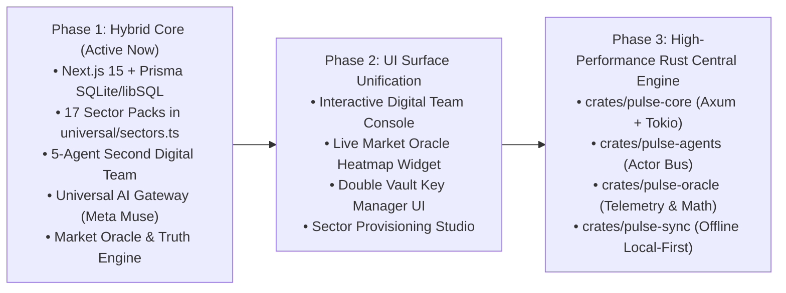

# United Beats LLC — Universal Business Operating System & CRM (NexusPulse OS)
## The Universal Autonomous Growth Engine for Every Business Scale and Sector

> **Blanket Technology Company:** UNITED BEATS LLC  
> **Platform Engine:** NexusPulse Universal OS (formerly RealEstateCRM Core)  
> **Core Philosophy:** *Grow with the Truth.* Real-time business & life numbers, an omnipresent autonomous Second Digital Team, unhallucinated mathematical goal pacing, and a pluggable AI hub natively integrated with **Meta Muse**.

---

## 1. Executive Vision: A Single Operating System for Any Industry

Most CRMs are either dumb address books or bloated enterprise software that require months of setup and still leave business owners guessing. 

**NexusPulse OS** is an end-to-end business operating system and autonomous growth engine designed for **any company scale and niche**:
- **Trades & Construction:** Roofing & Siding, Carpentry & Custom Woodwork, Masonry & Stone, Landscaping & Grounds, General Contracting.
- **Storefronts & Food:** Restaurants, Bars & Catering, Dollar Stores, Convenience Retail, Showrooms, Specialty Boutiques.
- **Industrial & Production:** High-throughput Factories, Industrial Manufacturing, Machine Shops, Supply Distributors.
- **Healthcare & Wellness:** Boutique Medical Clinics, Dental Practices, Wellness Centers, Physical Therapy.
- **Tech & Modern Commerce:** B2B SaaS Startups, Digital Agencies, E-Commerce & DTC Brands.
- **Professional Services:** Real Estate Brokerages, Law Firms, Accounting, Financial Planning & Insurance.

Whether you are a solo contractor on a roof, a family-owned restaurant, a boutique medical spa, or an industrial factory running multi-shift assembly lines, the core operational harness is identical: **leads in, pipelines accelerated, field/factory operations coordinated, client relationships nurtured, and numbers verified against mathematical reality.**

---

## 2. What Makes This CRM Different: The Growth & Truth Paradigm

### A. Real-Time Numbers from Your Business and Life
Most business dashboards show vanity metrics (clicks, impressions, raw follower counts). NexusPulse anchors your strategy in **ground-truth economics**:
- **True Gross Margin & Unit Economics:** Net profit after labor, materials, supplier invoices, and overhead.
- **Real Customer Acquisition Cost (CAC):** Blended cost per closed customer across paid ads, referral commissions, and staff time.
- **Capacity Utilization:** Direct visibility into whether your crews, technicians, tables, or machines have the physical hours to fulfill your targets.
- **Life Alignment:** Configure owner income goals, desired working hours, and cash reserve targets. The CRM reverse-engineers your business requirements so your company serves your life, rather than consuming it.

### B. Unhallucinated Business Truth & Mathematical Goal Pacing
AI assistants commonly suffer from sycophantic optimism—promising that "success is around the corner" without checking capacity. **NexusPulse uses unvarnished mathematics**:

$$\text{Required Leads} = \frac{\text{Target Monthly Revenue} / \text{Average Deal Value}}{\text{Historical Close Rate}}$$

$$\text{Fulfillable Capacity} = \text{Active Labor Units} \times \text{Max Deals Per Unit}$$

If a masonry contractor wants to hit \$100,000/month with an average ticket of \$5,000 and 2 crews that can only complete 4 jobs each, the CRM immediately flags:
> **"Labor Fulfillment Bottleneck:** Your 2 crews can fulfill at most 8 jobs (\$40,000/mo). Even with infinite leads, your operations cannot hit \$100,000/mo without hiring 3 more crews or increasing your prices by 150%."

### C. Top-of-Mind Relationship & Lead Retention Engine
Never let a lead or past client go cold:
- **Omnichannel Nurture:** 24/7 AI-driven conversational SMS, phone voice check-ins, email drip sequences, and client portal access.
- **Lifecycle Re-Engagement:** Automatic seasonal tune-up alerts for contractors, recall notices for clinics, VIP drops for retailers, and anniversary check-ins for real estate and wealth clients.
- **Review & Referral Loop:** Automatically triggers review requests and referral incentives within 24 hours of successful job sign-off.

### D. Leadership, Team Alignment & Data Segments
- **Keep Everyone in the Fold:** From executive leadership to shop-floor fabricators and field roofers, role-based access control (RBAC) ensures everyone sees their assigned tasks, milestones, and safety checklists without clutter.
- **Hyper-Targeted Dynamic Segmentation:** Segment leads and clients by lifetime value, geographic radius, lead source, stage velocity, or custom tags. Trigger automated smart workflows tailored to each distinct cohort.

---

## 3. The "Second Digital Team" (5-Agent Autonomous Workforce)

Every workspace is equipped with a pre-configured, coordinated digital workforce operating 24/7:



1. **Atlas (`ATLAS-01`) — Inbound Concierge & 24/7 Receptionist (Autonomous)**
   - Answers inbound phone calls with natural, human-grade voice; handles multi-lingual web chats and SMS.
   - Instantly triggers missed-call text-back so you never lose a job to a competitor.
   - Qualifies budget and timeline against sector standards and books consultations directly to the company calendar.

2. **Vanguard (`VANGUARD-02`) — Revenue & Pipeline Momentum Manager (Supervised)**
   - Tracks every open quote, bid, and contract across pipeline stages.
   - Drafts custom proposals using pre-approved templates and calculates closing probabilities.
   - Enforces follow-up cadences so proposals never sit unanswered.

3. **Forge (`FORGE-03`) — Operations & Field Dispatch Coordinator (Supervised)**
   - Coordinates daily job schedules, crew route density, and material supply deliveries.
   - Dispatches change orders with digital signature capture directly to client phones.
   - Verifies safety logs (OSHA, silica dust, PPE) and issues digital Certificates of Completion upon final punch-list sign-off.

4. **Oracle-X (`ORACLE-04`) — Market Intelligence & Hyper-Local Scout (Advisory)**
   - Monitors target local neighborhoods (1–50 mile radius) or global industry trends.
   - Tracks competitor pricing, search volume shifts, and raw material inflation (lumber, steel, asphalt, food commodities).
   - Generates hyper-targeted geotargeted ad hooks and marketing keywords.

5. **Sovereign (`SOVEREIGN-05`) — Executive Growth & Business Truth Consultant (Advisory)**
   - Conducts weekly mathematical audits of gross margins, burn rate, and acquisition costs.
   - Identifies whether marketing leaks or operational bottlenecks are holding back growth.
   - Delivers realistic, encouraging, and unhallucinated month-by-month roadmaps to hit revenue milestones.

---

## 4. Meta Muse Special Package & Pluggable Multi-Model AI Hub

NexusPulse features a dedicated **Universal AI Gateway** (`src/lib/universal/ai-gateway.ts`) allowing any AI to plug in, with an exclusive premier integration for **Meta Muse**.

```
┌──────────────────────────────────────────────────────────────────────────┐
│                   UNIVERSAL AI GATEWAY & SEQUENCING BUS                  │
└────────────────────────────────────┬─────────────────────────────────────┘
                                     │
         ┌───────────────────────────┼───────────────────────────┐
         ▼                           ▼                           ▼
 ┌───────────────┐           ┌───────────────┐           ┌───────────────┐
 │   Meta Muse   │           │ Google Gemini │           │Anthropic Claude│
 │  Multimodal   │           │ 2.5 Flash/Pro │           │  3.5 Sonnet   │
 │Creative/Vision│           │  Voice/Audio  │           │Legal/Contracts│
 └───────┬───────┘           └───────┬───────┘           └───────┬───────┘
         │                           │                           │
         └───────────────────────────┼───────────────────────────┘
                                     ▼
 ┌───────────────────────────────────────────────────────────────────────┐
 │                      SEQUENTIAL MULTI-MODEL FLOW                      │
 │ 1. Meta Muse analyzes site photos / blueprints / factory line video   │
 │ 2. Gemini handles ultra-low latency voice intake on the phone        │
 │ 3. Claude reviews contracts, MSAs, and regulatory compliance          │
 │ 4. DeepSeek verifies mathematical margin accuracy and cash flow       │
 └───────────────────────────────────────────────────────────────────────┘
```

### The Meta Muse Advantage:
- **Multimodal Visual Job-Site Audits:** Field technicians take photos of roofs, framing, masonry cracks, or factory machinery. Meta Muse inspects the imagery for defects, measurements, or inventory counts and binds the analysis directly to the customer work order.
- **Hyper-Targeted Local Ad Creative:** Generates photo-realistic local social media ad creatives, video storyboards, and geotargeted copy referencing specific neighborhoods, weather conditions, or local landmarks.
- **Brand Storytelling & Content Automation:** Synchronizes with your content calendar to generate authentic before/after showcases, customer success stories, and educational trade guides.

### Sequential AI Execution:
Unlike systems that force you to pick a single model, NexusPulse runs models in **harmonious sequence**:
1. **Gemini 2.5 Flash:** Handles instant live voice calls with sub-300ms latency.
2. **Meta Muse:** Analyzes visual inputs, job-site photos, blueprints, and generates social assets.
3. **Claude 3.5 Sonnet:** Drafts contracts, change orders, and verifies regulatory disclosures.
4. **DeepSeek V3 / R1:** Audits financial models, DSCR, amortization, and gross margins.
5. **Local Ollama / vLLM:** Keeps sensitive trade secrets or medical intake completely on-premise without cloud egress.

---

## 5. The "Double Vault Safe" (Zero-Leakage Security Architecture)

Enterprise and small business trust requires absolute separation between user credentials, AI models, and public networks. NexusPulse implements a **Double Vault Safe** security model:

```
┌──────────────────────────────────────────────────────────────────────────┐
│                       DOUBLE VAULT SAFE ARCHITECTURE                     │
├────────────────────────────────────┬─────────────────────────────────────┤
│   VAULT 1: AT-REST CRYPTO VAULT   │   VAULT 2: RUNTIME ENCLAVE BARRIER  │
│  (Database & Environment Layer)   │      (In-Memory AI Execution)       │
├────────────────────────────────────┼─────────────────────────────────────┤
│ • AES-256-GCM authenticated keys   │ • Zero-leakage prompt sanitizer     │
│ • Hardware secret isolation        │ • Ephemeral credential decryption   │
│ • Strict workspaceId row scoping   │ • Blocks prompt-injection exfil     │
│ • Formula-safe CSV export sanitize │ • Zero telemetry to untrusted LLMs  │
└────────────────────────────────────┴─────────────────────────────────────┘
```

1. **Vault 1 — At-Rest Cryptographic Vault (`src/lib/encryption.ts` & Vault DB):**
   - All third-party secrets (Stripe private keys, Twilio auth tokens, Meta Muse credentials, OpenAI keys, MLS feeds) are encrypted with unique initialization vectors using **AES-256-GCM**.
   - Decryption occurs server-side only when an authorized Server Action or authenticated worker requests an execution. Keys are never transmitted to client browsers.
   - Prevents SQL / CSV formula injection (`=`, `@`, `+`, `-`) across all workspace exports.

2. **Vault 2 — Runtime Enclave & Prompt Isolation Safe:**
   - When communicating with external AI APIs, sensitive customer Personally Identifiable Information (PII) is tokenized or masked.
   - System prompts and tool-execution outputs are scrubbed to prevent adversarial prompt injection from exfiltrating stored API keys or cross-tenant records.
   - Provides enterprise-grade peace of mind for medical clinics (HIPAA), legal practices (IOLTA/Privilege), and financial advisors (GLBA).

---

## 6. Sector Specialization Packs (17 Out-of-the-Box Business Engines)

Every business gets native vocabulary, tailored pipeline stages, automated templates, and compliance guardrails. Switching sectors reconfigures the platform instantly without rewriting code:

| Sector Pack ID | Industry Name | Customer Term | Work Unit Term | Offering Term | Key Metric Focus |
| :--- | :--- | :--- | :--- | :--- | :--- |
| `roofing` | **Roofing & Exterior Trades** | Homeowner | Roofing Project | Estimate | Inspection close rate, margin/sq |
| `carpentry` | **Carpentry & Custom Woodwork** | Client | Custom Build | Spec & Estimate | Shop utilization, profit/hour |
| `masonry` | **Masonry, Brick & Stone** | Property Owner | Masonry Job | Estimate | Sq footage laid, material cost |
| `landscaping` | **Landscaping & Grounds Care** | Client | Service Route | Proposal | Route density, recurring revenue |
| `construction` | **General Contracting** | Customer | Job | Bid | Win rate, change order margin |
| `manufacturing`| **Factories & Industrial Mfg** | Client / OEM | Production Run | Manufactured Unit | OEE, defect rate, on-time delivery |
| `restaurant` | **Restaurants & Food Service** | Guest / Host | Event / Booking | Menu & Package | Food cost %, cover average |
| `discount-retail`| **Dollar Stores & Retail** | Shopper | Purchase Order | Merchandise | Basket size, GMROI, foot traffic |
| `ecommerce` | **E-Commerce & DTC Brands** | Customer | Order | Product | CAC, ROAS, LTV, refund rate |
| `tech-saas` | **Tech Startups & B2B Software** | Account | Opportunity | Subscription | MRR, sales cycle length, NRR |
| `healthcare` | **Healthcare & Medical Clinics**| Patient | Case | Appointment | No-show rate, recall retention |
| `legal` | **Legal Services & Law Firms** | Client | Matter | Consultation | Billable pipeline, deadlines |
| `finance` | **Finance & Wealth Management** | Policyholder | Policy / Account | Quote | Bind rate, renewals, AUM |
| `real-estate` | **Real Estate Brokerages** | Client | Deal | Listing | Closings, commission, pipeline |
| `home-services`| **HVAC, Plumbing & Electrical** | Homeowner | Service Call | Service Plan | Jobs/tech, maintenance plans |
| `hospitality` | **Hotels & Event Venues** | Guest | Booking | Reservation | Occupancy, repeat rate, reviews |
| `retail` | **Showrooms & Boutiques** | Shopper | Order | Product | Repeat buyer rate, avg basket |

---

## 7. Top-to-Bottom Balanced Interface: Never Miss a Step

The platform combines extreme technical density with an intuitive, clutter-free luxury interface:
- **Command Center:** 36+ integrated dashboards accessible in one click with built-in tooltips and keyboard shortcuts.
- **Unified Activity Timeline:** Every phone call recording, SMS thread, email exchange, proposal version, field photo, and payment receipt is unified under the client’s single activity stream.
- **Workflow State Machine (`WorkflowSession`):** Multi-step contracts, site inspections, and design drafts can be saved as in-progress drafts, resumed from mobile or desktop, and locked upon electronic signature.
- **Multi-Tenant Global Switcher:** Business owners with multiple entities (e.g. a roofing company and a real estate holding company) can switch workspaces seamlessly with zero data bleeding.

---

## 8. Transition Plan: From RealEstateCRM to Standalone Rust Core



### What We Preserved and Re-Engineered from RealEstateCRM:
1. **Workspace RBAC & Role Hierarchy:** Owner, Admin, Manager, and Field Agent roles ported and broadened for all industries.
2. **Dynamic Workflow Engine:** Server-backed `WorkflowSession` model for saving, resuming, and executing complex multi-step forms.
3. **Double Vault Key Storage:** Cryptographically hardened AES-256-GCM secret storage powering AI and payment integrations.
4. **Formula-Safe CSV Export:** Enterprise-grade sanitization preventing spreadsheet formula execution across accounting and CRM exports.
5. **Multi-Lingual Localization:** 16 launch languages with native RTL support (Arabic, Hebrew) built into every interface component.

---

## 9. Quick Start & Developer Guide

### Prerequisites
- Node.js 20+ (tested on Node v26.13+)
- npm or pnpm

### Setup
```bash
# 1. Install dependencies
npm install

# 2. Configure environment
cp .env.example .env

# 3. Generate database & run seed
npx prisma generate
npx prisma db push

# 4. Run full test suite (111 passing tests)
npm test

# 5. Start development server
npm run dev
```

### Verifying Universal Modules
```bash
# Run universal sector, digital team, AI gateway, and market oracle tests
node --test tests/universal.test.mts
```

---

## 10. Summary & Brand Blanket

**NexusPulse OS** is proudly engineered under the **UNITED BEATS LLC** blanket technology umbrella. It represents the next frontier of business software: where customer relationship management, field operations, autonomous digital teammates, and cold business reality unite into a single, beautiful tool for every business owner on Earth.
